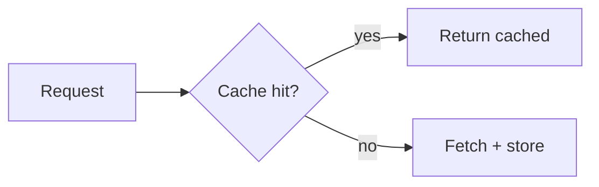

# Markdown syntax reference

The exhaustive how-to-write-every-element reference, loaded on demand. For each
element: the exact syntax, a worked example, and a portability note.
`references/formatting.md` is the doctrine layer (when and why); this file is the
syntax layer (how). For the complete Obsidian callout system see
`references/admonitions.md`; for the machine-readable callout aliases see
`assets/callout-types.json`.

## Portability legend

Every element below is tagged with where it renders:

- **CommonMark** - the portable baseline; renders nearly everywhere.
- **GFM** - GitHub Flavored Markdown; a strict superset of CommonMark. Note the
  spec-versus-renderer gap: the frozen 2019 GFM spec adds only five things
  (tables, task lists, strikethrough, autolinks, raw-HTML filtering), while
  GitHub's live renderer also does alerts, footnotes, emoji shortcodes, and
  mentions, which are not in the spec and will not work on a generic GFM engine.
- **Obsidian-only** - Obsidian Flavored Markdown; degrades to literal text
  elsewhere. The vault renders it in full.

The rule of thumb: target CommonMark plus the single platform you publish to, and
keep the raw source legible as plain text.

---

## Structure

### Headings (ATX)

**Syntax.** One to six `#` characters, a space, then the text. ATX form only; do
not use the Setext underline (`===` / `---`) form.

```markdown
# Title (H1)
## Section (H2)
### Subsection (H3)
```

**Rules that are not optional.** Use exactly **one H1**, the title, and **never
skip levels**: an H3 only ever appears under an H2, never directly under an H1.
Skipped levels break screen-reader navigation, and most screen-reader users move
through a document by its headings. Front-load the key word, keep headings
parallel in grammar at one level, and never end a heading with a period. Put a
blank line above and below every heading.

> Where the file lives sets its heading style, which is not part of CommonMark. A
> vault note follows `AGENTS.md`, Conventions: its single H1 opens with one
> fitting emoji, then a space, then the title, and its YAML `title` stays plain.
> A page GitHub renders (any `README.md`, `AGENTS.md`, and the files under
> `.docs/` and `.github/`) follows standards'
> [Document Styling guide](https://github.com/tannergolden/standards/blob/Development/docs/technical/interface/Document-Styling-&-Formatting.md).

**Portability:** CommonMark.

### Horizontal rules

**Syntax.** Three or more `-`, `*`, or `_` on their own line, blank lines around
it. Pick one marker and hold it; `---` is the common choice.

```markdown
Section above.

---

Section below.
```

Keep `---` distinct from a Setext H2 underline: a horizontal rule has a blank
line above it, whereas `---` directly under a line of text turns that text into a
heading. Always leave the blank line.

**Portability:** CommonMark.

---

## Inline

### Emphasis: bold, italic, strikethrough, highlight

**Syntax.**

```markdown
*italic* or _italic_
**bold** or __bold__
***bold italic***
~~strikethrough~~
==highlight==
```

**Worked example.** "This is **important**, this is *nuanced*, this is ~~retracted~~."

**Conventions.** Prefer **asterisks** over underscores for both bold and italic;
asterisks work mid-word (`super*cali*` ) where underscores do not, and a single
consistent marker keeps the source clean.

**Portability:**

- Bold and italic: CommonMark.
- Strikethrough (`~~`): GFM (and Obsidian).
- Highlight (`==text==`): **Obsidian-only**; degrades to literal `==text==`
  elsewhere, so it never leaves the vault.

### Inline code

**Syntax.** Wrap in single backticks. To include a literal backtick, wrap in
double backticks.

```markdown
Use the `--write` flag.
Render `` `backtick` `` literally.
```

Use inline code for identifiers, filenames, flags, and literal values in prose.

**Portability:** CommonMark.

### Links (inline, reference-style, autolink)

**Syntax.**

```markdown
[inline link](https://example.com "optional title")
[reference link][ref]
<https://autolink.example.com>

[ref]: https://example.com "optional title"
```

**Worked example.** Inline for one-offs; reference-style when the same URLs repeat
or link-heavy prose gets hard to read in source:

```markdown
See the [spec][cm] and the [docs][gh].

[cm]: https://spec.commonmark.org/
[gh]: https://docs.github.com/
```

**Conventions.** Use descriptive link text; never link the bare words "here" or
"click here". CommonMark treats inline and reference links as equivalent, so the
choice is readability, not correctness. An autolink needs the angle brackets;
GFM also auto-detects bare URLs without them.

> Wikilinks and embeds are a separate, Obsidian-only link system. A wikilink is a
> note name wrapped in doubled square brackets; an embed (transclusion) is the
> same with a leading exclamation mark. They render only in Obsidian and degrade
> to raw text everywhere else, so they stay inside the vault and a piece leaving
> the vault converts them to real links or plain text. For the exact literal
> bracket forms, and where a wikilink may go, see `.docs/technical/vault/Link-Topology.md`.

**Portability:** inline, reference, and autolinks are CommonMark; bare-URL
autodetection is GFM; wikilinks and embeds are Obsidian-only.

### Images with alt text

**Syntax.** An image is a link with a leading exclamation mark; the bracketed
text is the alt text.

```markdown

```

**Alt text rule.** Alt text states the image's **function in context**, not a
generic label. A vault note and a page GitHub renders follow the alt-text rule in
standards' [Document Styling guide](https://github.com/tannergolden/standards/blob/Development/docs/technical/interface/Document-Styling-&-Formatting.md) (Rich Media & Accessibility):
every image, badges included, carries descriptive alt text. Only in a piece
leaving the vault may a purely decorative image take **empty** alt so assistive
technology skips it:

```markdown

```

**Portability:** CommonMark. (Obsidian also embeds local images with its
exclamation-mark wikilink embed syntax, which is Obsidian-only.)

### Hard, soft, and semantic line breaks

**Soft break.** A single newline in the source is joined into the same rendered
paragraph as a space. This is what lets semantic line breaks work.

**Hard break.** End a line with **two trailing spaces**, then a newline, to force
a line break inside one paragraph. Because trailing spaces are invisible and
fragile, prefer an explicit `<br>` when you truly need a hard break.

```markdown
Line one ending with two spaces.··
Line two, same paragraph.
```

**Semantic line breaks.** Start a new **source** line after each sentence (and
optionally after independent clauses), with a roughly 80-character maximum.
Markdown joins the lines with a space, so the rendered output is unchanged while
the source diff stays sentence-level and clean. Pick one wrapping policy
(semantic breaks, or one long soft-wrapped line per paragraph) and hold it across
a file; do not mix the two.

**Portability:** soft breaks, semantic breaks, and both CommonMark hard-break
forms (two trailing spaces, or a trailing backslash before the newline) are
CommonMark. `<br>` is raw HTML (renders on GitHub and Obsidian; some strict
renderers strip it); house style still prefers it for visibility.

### Escaping

**Syntax.** Precede a markdown control character with a backslash to render it
literally: `\* \_ \` \# \[ \] \( \) \\ \| \~`.

```markdown
\*not italic\* renders as literal asterisks.
1\. not a numbered list.
```

Escape a literal pipe inside a table cell as `\|` (see Tables).

**Portability:** CommonMark.

---

## Blocks

### Lists (unordered, ordered, nested, task)

**Unordered.** One consistent marker across the project; `-` is recommended.

```markdown
- first
- second
- third
```

**Ordered.** Use `1.` with a period (not `1)`). You may number every item `1.`
and let the renderer count, which makes reordering diff-free.

```markdown
1. first
1. second
1. third
```

**Nested.** Indent a child by **two spaces** under its parent. Put a blank line
before and after every list.

```markdown
- parent
  - child
    - grandchild
```

**Task lists.** A bracket with a space is open, a bracket with an `x` is done.

```markdown
- [ ] open task
- [x] done task
```

**Portability:** unordered, ordered, and nested lists are CommonMark. Task lists
are GFM (and Obsidian); they render as plain bracket text on a pure CommonMark
engine.

### Blockquotes

**Syntax.** Prefix each line with `>`. Nest by stacking markers (`> >`). A
blockquote may contain other markdown (lists, code, even nested quotes).

```markdown
> A quoted line.
>
> > A nested quote.
```

A blockquote whose first line is a bracketed bang-type marker becomes a **callout
or alert** (see `references/admonitions.md`).

**Portability:** CommonMark. (The bracketed-type callout layer on top is
Obsidian, with a five-type uppercase subset on GitHub.)

### Fenced code blocks (with language info string)

**Syntax.** Three or more backticks (or tildes) open and close the block. The
first word after the opening fence is the **info string**: set it to the language
so the renderer highlights it. Always use fenced blocks, never indented ones, and
put a blank line before and after.

````markdown
```python
def greet(name: str) -> str:
    return f"Hello, {name}"
```
````

Use `text` for plain output and `diff` for diffs. To show backtick fences inside
a fence (as here), wrap the outer fence in **four** backticks.

**Portability:** CommonMark (the info string is part of the spec; syntax
highlighting itself is renderer-provided). Lower-case language identifiers are the
safe convention. Line numbering and line-highlighting are not native to Obsidian
(they need a plugin), though GitHub and some renderers provide them; do not rely
on them in a vault file.

### Footnotes

**Syntax.** A marker in the text and a matching definition elsewhere (commonly the
bottom of the file).

```markdown
A claim that needs a citation.[^src]

[^src]: The supporting source, https://example.com.
```

**Portability:** **not** CommonMark and **not** in the frozen GFM spec, although
GitHub's live renderer and Obsidian both support them. Treat as
GitHub-renderer-plus-Obsidian, not portable.

---

## Rich content

### Tables (alignment, pipe escaping)

**Syntax.** Pipes separate columns; the second row is the delimiter row of
hyphens. **Colons** in the delimiter row set column alignment: `:---` left,
`---:` right, `:---:` center. Use at least three hyphens per column. Cells need
not be padded to equal width in the source (a formatter aligns them). Escape a
literal pipe inside a cell as `\|`.

```markdown
| Name  | Type   | Required |
| :---- | :----: | -------: |
| id    | string |      yes |
| label | string |       no |
```

**Conventions.** Keep tables narrow; if a table needs horizontal scrolling, a
list usually reads better. A cell is single-line: it cannot contain a hard
return, so use `<br>` for a forced break inside a cell.

**Portability:** GFM (and Obsidian). Tables do **not** render in plain CommonMark
or in Discord.

### LaTeX math (inline and block)

**Syntax.** Inline math between single dollar signs; block (display) math between
double dollar signs, or in a fenced block whose info string is `math`.

```markdown
Inline: $E = mc^2$

Block:

$$
\int_0^1 x^2 \, dx = \tfrac{1}{3}
$$
```

**Portability:** **not** CommonMark. GitHub renders LaTeX via MathJax (launched
May 2022) and Obsidian renders it via MathJax as well; GitLab and Hugo default to
KaTeX, which is lighter. MathJax covers math-mode LaTeX only, a subset: no
`\usepackage`, TikZ, or document-class commands, so write equations, not whole
LaTeX documents. Confirm the engine on your target, and in a portable
document provide an image fallback or note that rendering needs a specific
platform.

### Mermaid diagrams

**Syntax.** A fenced code block whose info string is `mermaid`. The first token of
the body declares the diagram type.

````markdown

````

**Match the diagram type to the relationship.** Reach for the type whose shape is
the data's shape, never for variety:

| Relationship to show | Mermaid type | Declaration keyword |
| :--- | :--- | :--- |
| A process or decision flow | Flowchart | `flowchart` (or `graph`) |
| Interactions between actors over time | Sequence | `sequenceDiagram` |
| Object or type structure | Class | `classDiagram` |
| States and transitions | State | `stateDiagram-v2` |
| Data entities and relationships | Entity-relationship | `erDiagram` |
| A schedule or timeline of tasks | Gantt | `gantt` |
| Parts of a whole / proportions | Pie | `pie` |
| Steps a user takes, with sentiment | User journey | `journey` |
| Branch and commit history | Git graph | `gitGraph` |
| Nested ideas around a center | Mindmap | `mindmap` |
| Dated events in order | Timeline | `timeline` |

Mermaid offers roughly two dozen types in total; the rows above are the stable,
widely-rendered set. Newer types (sankey, block, kanban, architecture, and
others) exist but are marked experimental, so confirm support before relying on
them.

**Portability:** **not** CommonMark. GitHub and GitLab render a `mermaid` fence
natively; Obsidian renders it via its Mermaid core plugin. A pure CommonMark
engine shows the raw fence text. GitHub also natively renders three other diagram
syntaxes in a fence (`geojson`, `topojson`, and ASCII STL).

> Editorial-versus-visualize boundary: a Mermaid diagram **inside a file under
> edit** is editorial; a diagram requested **as a chat answer** is the
> `visualize` skill. The trigger follows the artifact, not the diagram.

---

## Quick portability table

| Element | CommonMark | GFM | Obsidian |
| :--- | :---: | :---: | :---: |
| Headings, emphasis, links, images, lists, blockquotes, code, rules, escaping, line breaks | yes | yes | yes |
| Tables | no | yes | yes |
| Strikethrough `~~` | no | yes | yes |
| Task lists | no | yes | yes |
| Footnotes | no | renderer | yes |
| Highlight `==text==` | no | no | yes |
| Wikilinks / embeds | no | no | yes |
| LaTeX math | no | renderer | yes (MathJax) |
| Mermaid | no | yes | yes (plugin) |

"renderer" means GitHub's live renderer does it but the frozen GFM spec does not,
so it is not safe on a generic GFM engine. When a file leaves the vault, drop
every Obsidian-only construct and keep to the target's real capabilities.
